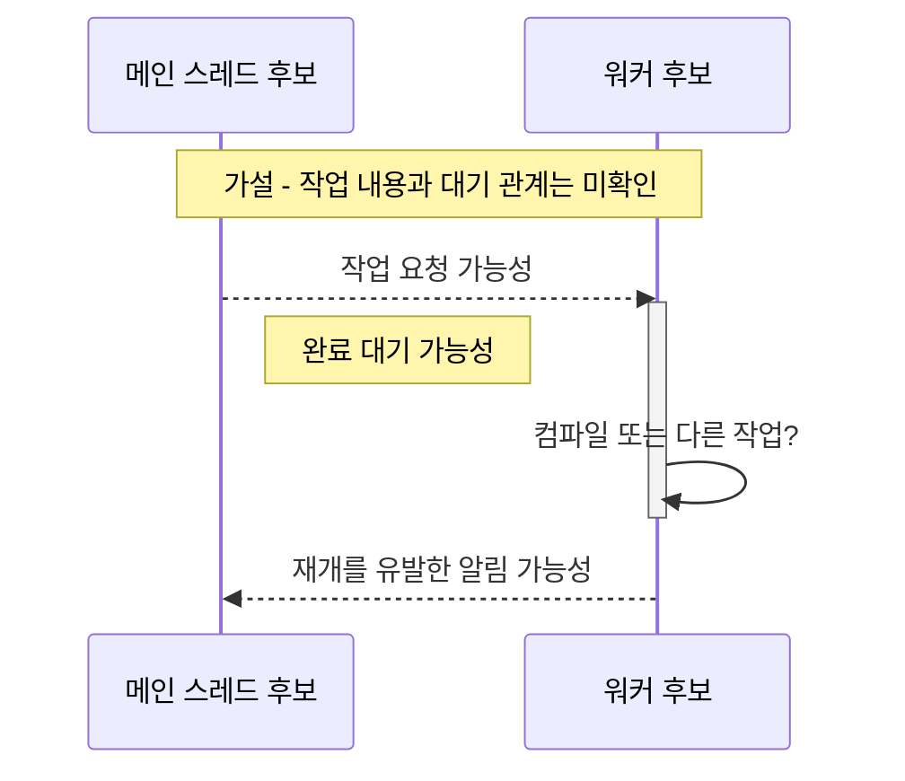

> ⚠️ **작성자 알림 (2026-08-10)** — 본 글의 실험은 측정 조건과 설계에 한계가 있어, 결과 해석에 주의가 필요함을 밝힙니다. 현재 마비노기는 DXVK가 게임사에서 공식 채택되어 적용되고 있습니다. 아래 내용은 이러한 배경을 감안하여 참고 바랍니다.

> **해석 범위 보완 (2026-10-13)** — 본문에서 사용했던 “증명”, “입증” 등의 인과관계 단정 표현을 수정했습니다. 아래 자료는 당시 제 환경에서 수집한 제한된 측정 기록입니다. 메인 스레드의 CPU 활동 감소와 워커 활동 증가가 같은 구간에서 보인다는 사실만으로, 특정 컴파일 작업이 메인 스레드를 대기시켰다고 확정할 수는 없습니다. 당시 결과를 현재 공식 적용 환경의 성능 평가로 일반화하지 않습니다.

> **요약 (Abstract)**
> 이전 벤치마크의 측정 조건에서는 DXVK 적용 상태의 평균 프레임(Avg FPS)과 1% Low FPS가 순정 상태보다 낮았습니다. 본 포스팅에서는 Windows Performance Analyzer (WPA)로 스레드 활동을 살펴보고, 메인 스레드로 추정한 스레드의 CPU 활동 감소와 워커 활동 증가가 겹치는 구간을 정리합니다. 동기화 대기나 컴파일 지연은 가능한 설명이지만, 제시한 자료만으로 원인 작업과 대기 관계를 확정하지는 못했습니다.

---

## 1. 문제 제기: 1% Low 하락 구간에서 어떤 스레드 활동이 보이는가?

이전 글에서 제시했던 원인 후보 중 하나는 셰이더·파이프라인 컴파일 지연이었습니다. 이 가설을 검토하기 위해 순정 D3D9 환경과 DXVK 환경의 시스템 스케줄링 데이터를 대조했습니다. 다만 이 비교는 반복 측정과 캐시 상태 등의 통제가 충분히 제시된 실험이 아니므로, 특정 작업의 인과적 효과를 분리한 A/B 테스트로 보기는 어렵습니다.

## 2. 거시적 관점: 동기화 관련 이벤트의 밀도 차이

운영체제 커널 레벨에서 발생하는 이벤트의 밀도를 먼저 비교해 보았습니다.

위 WPA 화면에서는 DXVK 환경에 `SignalSynchronization`, `WorkerThread` 등의 이벤트 블록이 더 조밀하게 나타납니다. 이는 동기화 관련 활동을 더 살펴볼 단서입니다. 다만 이벤트 수나 화면상의 밀도가 곧 대기 시간 또는 CPU 비용을 뜻하지는 않습니다. 수집 설정·표시 범위·측정 길이를 맞추고 이벤트별 시간과 스레드 상태를 비교해야 오버헤드의 차이를 평가할 수 있습니다.

## 3. 미시적 관점: CPU 활동 감소와 워커 활동 증가의 동시 관측

스터터링과 관련이 있다고 판단한 21초~23초 구간을 CPU Usage 타임라인에서 확대해 보았습니다. 프레임 타임과 스케줄링 이벤트를 같은 시간축에서 대조하는 작업은 추가 검증 과제로 남습니다.

화면에서 관측되는 것은 메인 스레드로 추정한 하늘색 선의 CPU 활동이 낮아지는 구간에 워커로 추정한 빨간색 선의 활동이 증가한다는 점입니다. CPU 사용률이 낮다는 사실만으로 **대기(Wait)**, 실행 가능한 상태에서의 스케줄링 지연(Ready), 또는 일감이 없는 상태를 구분할 수는 없습니다. 스레드 역할도 이름·ID·호출 스택을 함께 확인해야 합니다.

동기화된 워커 작업을 기다렸을 가능성은 있지만, 두 활동의 시간적 겹침만으로 “워커의 컴파일 때문에 메인 스레드가 멈췄다”는 인과관계를 확정할 수는 없습니다. 아래 도표는 **검증할 가설**을 단순화한 것이며, 로그에서 확인한 실행 순서가 아닙니다.

## 4. 호출 스택의 단서: d3d9.dll

워커로 추정한 스레드의 작업 경로를 살펴보기 위해 콜 스택(Call Stack)을 확인했습니다.

제시한 스택에는 `d3d9.dll`이 나타납니다. 당시 DXVK를 적용한 실행 조건과 함께 보면 DXVK 경로의 작업을 조사할 단서가 됩니다. 다만 모듈 이름만으로 로드된 DLL의 구현을 식별하거나 작업을 셰이더·파이프라인 컴파일로 특정할 수는 없습니다. 로드 경로·버전과 함수 수준의 심볼을 확인하고, 해당 작업이 메인 스레드의 대기 해제에 연결되는지도 추적해야 합니다.

## 5. 추가 검증: 작업과 대기 관계를 어떻게 구분할 것인가?

- **시간축과 스레드 상태 확인:** 프레임 타임 스파이크와 ETW 이벤트를 같은 시간축에서 대조하고, 컨텍스트 스위치·Ready 시간·대기 진입 스택을 통해 CPU 활동 감소의 상태를 구분합니다.
- **작업과 의존 관계 확인:** 로드된 모듈과 심볼로 워커의 함수·작업을 식별하고, 대기 대상과 메인 스레드를 깨우는 스레드의 관계를 추적합니다. 컴파일 이벤트와 완료 시점까지 연결되어야 컴파일 대기 가설을 더 강하게 평가할 수 있습니다.
- **조건을 통제한 반복 비교:** 게임·DXVK·드라이버 버전, 전원·온도 조건, 장면과 측정 순서를 기록하고, 캐시가 비어 있는 실행과 충분히 워밍업한 실행을 구분해 반복 측정합니다. 캐시 조건에 따른 차이도 다른 요인이 함께 바뀌지 않았는지 확인해야 합니다.

## 6. 결론: 관측한 차이와 아직 확인하지 못한 원인

**관측한 사실**은 당시 제 하드웨어(i5-14500HX + RTX 4060 Laptop)의 벤치마크에서 DXVK 적용 상태의 평균·Low FPS가 낮았고, 제시한 WPA 구간에서 메인 스레드로 추정한 스레드의 CPU 활동 감소와 워커 활동 증가가 겹쳤다는 점입니다.

**가능한 설명**은 동기화 대기, 셰이더·파이프라인 컴파일, 번역·제출 경로의 비용입니다. 스케줄링 지연이나 다른 게임·드라이버 작업도 배제하지 못했습니다. **추가 검증이 필요한 부분**은 실제 대기 여부, 워커의 작업 내용, 그 작업과 프레임 지연 사이의 의존 관계 및 재현성입니다.

따라서 이 분석은 원인 후보를 좁히기 위한 탐색적 기록입니다. 실시간 컴파일이 1% Low 하락을 일으켰다거나, 마비노기와 DXVK 사이에 구조적 호환성 문제가 있다고 결론 내릴 근거는 충분하지 않습니다.
